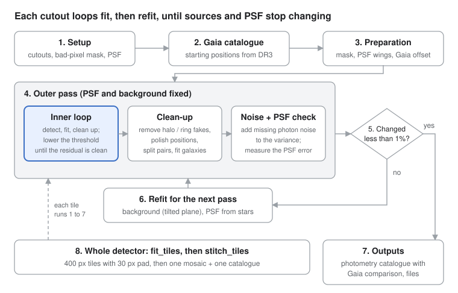

# meas_crowd: how the pipeline works, step by step

What every step of the pipeline does, why it is there, and the exact rules behind its decisions,
with the configuration option and default for every threshold.  For running the pipeline see
[pipeline_guide.md](pipeline_guide.md); for function signatures,
[function_reference.md](function_reference.md).

- [Conventions used below](#conventions-used-below)
- [1. Setup](#1-setup)
- [2. Gaia catalogue](#2-gaia-catalogue)
- [3. Preparation](#3-preparation)
- [4. Outer pass](#4-outer-pass)
    - [4a. Inner loop: find and fit sources](#4a-inner-loop-find-and-fit-sources)
    - [4b. Clean-up at the end of the pass](#4b-clean-up-at-the-end-of-the-pass)
    - [4c. Noise and PSF-error check](#4c-noise-and-psf-error-check)
- [5. Convergence test](#5-convergence-test)
- [6. Refit for the next pass](#6-refit-for-the-next-pass)
- [7. Outputs: photometry and the Gaia comparison](#7-outputs-photometry-and-the-gaia-comparison)
- [8. Whole detector](#8-whole-detector)
- [Summary of the decision rules](#summary-of-the-decision-rules)

## Conventions used below

- **S/N** usually means **peak S/N**: the source's flux × the PSF's peak value ÷ the typical pixel
  noise, i.e. how many σ its brightest pixel stands above the noise.  Where the integrated S/N of
  the fitted flux is meant (flux ÷ its error over the whole PSF), it says **flux S/N**.
- **Gaia sources** are sources whose fit started from a Gaia position and kept that link;
  **other sources** were found in the residual.
- **χ²** is Σ (residual / σ)²; **local χ²** sums a few FWHM around a source.
- **Effective variance**, used to weight every fit:
  `variance + (sys_frac × model)² + poisson_k × model`, with `sys_frac = 0.03` (a 3 % allowance
  for PSF imperfection) and `poisson_k` from the noise check (4c, 0 until then).
- Options are the keys of `crowd.PIPELINE_DEFAULTS` / `CROWDED_FIELD_CONFIG`; the defaults are
  those of `CROWDED_FIELD_CONFIG` (the recommended configuration).

## 1. Setup

`prepare_session(visit, detector, cutouts, pad, psf_source)`

**Why.**  Everything the fits need from the visit: pixels, which pixels to trust, and a starting
PSF.

1. **Load the `visit_image`** (Butler) and cut out each requested box grown by `pad` px (20 in
   the examples).  The padding is fitted too, so stars just outside the box are modelled
   together with their neighbours inside it; only the requested box (`in_interior`) is reported.
2. **Bad pixels:** SAT, CR, BAD, INTRP and EDGE mask planes are excluded from every fit.
3. **Detector-level PSF** (`psf_source`):
    - `"visit"` (recommended): the PSF stored with the visit image.  The visit image is already
      background-subtracted, so no further background is removed here.
    - `"refit"`: a new PSF from this detector: subtract an Akima-spline background (kept as
      `session.bgImage`), detect at 3σ, deblend and measure, select stars by size
      (`ObjectSizeStarSelectorTask`), fit a PCA PSF (spatial order 1, 512 px cells, up to 10 stars
      per cell, blends rejected).  The candidate and used stars are kept (`session.starCat`,
      `session.psf_used_xy`).

**See it:** `crowd.show_psf_stars(...)` (guide recipe 2).

## 2. Gaia catalogue

`attach_gaia(session)`, `select_gaia_sources(...)`

**Why.**  In a crowded field most stars are blended; starting from Gaia's positions (accurate to
milliarcseconds) gives the fit the right number of stars in the right places from the first
iteration, which detection alone cannot do in a blend.

1. **Load Gaia DR3** over the whole detector (+64 px): from the Butler reference catalogue
   (`gaia_dr3_20230707`, proper motions applied by the loader) or, if that fails, from the ESA
   archive (proper motions applied linearly).  Positions are moved to the visit's epoch and
   placed on the detector with the visit WCS.  The table is cached in `gaia_cache/`.
2. **Starting positions of a cutout:** the Gaia stars inside the fitted box grown by
   `gaia_pad_fwhm` = 1.5 FWHM (stars just outside still add light inside), brightest first;
   entries closer than `gaia_min_sep_px` = 0.5 px to a brighter one are dropped as duplicates;
   optionally only stars brighter than `gmag_max`.

## 3. Preparation

Start of `run_adaptive_pipeline`, once per cutout.

| Step | What and why | Option (default) |
| --- | --- | --- |
| Grow the saturated mask | Pixels next to saturated ones are non-linear or carry spilled charge; they are excluded too | `sat_grow_px` (2 px) |
| Near-saturated cores | Optional: exclude pixels above a fraction of the saturation level and fit those stars from their wings | `near_sat_frac` (0 = off) |
| Saturated-star zones | A band around each saturated blob (following its shape, so bleed trails stay narrow) where halo and spike speckle would otherwise become fake sources: other sources need S/N ≥ 10 there, and the residual check ignores the zones | `sat_zone_fwhm` (2), `sat_zone_scale` (1), `sat_zone_snr` (10), `sat_zone_min_px` (4) |
| Extend the PSF wings | The visit PSF is a 41 px kernel; bright stars' wings reach further.  The kernel is extended to 81 px with a Moffat profile fitted to it and blended in between 12 and 16 px | `psf_wing_size` (81), `psf_ext_blend` (12, 16) |
| Regularise the PSF | Outside 1.5 FWHM the kernel is rebuilt as a smooth, monotonically falling radial profile × a smoothed angular pattern: no holes or hot pixels, while ellipticity, lobes and spikes survive | `psf_regularize` (on), `psf_reg_core_fwhm` (1.5), `psf_reg_sigma` (1 px) |
| Initial background | `psf_source="refit"` only: subtract `session.bgImage` | `subtract_initial_bg` (on) |
| Gaia offset | A common shift between Gaia (through the WCS) and the image: the median offset of windowed centroids of ≥ 5 bright (S/N ≥ 20), unsaturated, isolated Gaia stars is applied to all Gaia positions | `fit_gaia_offset` (on) |

## 4. Outer pass

One full fit of the cutout with the PSF and background held fixed.  Repeated (steps 4–6) until
the source list and the PSF stop changing.

### 4a. Inner loop: find and fit sources

`run_inner_adaptive`

**Why.**  Faint stars only become detectable once the bright ones around them are modelled and
subtracted; so the pipeline detects, fits and subtracts in rounds, going deeper each round,
until what is left looks like noise.

**Warm start.**  The current sources (the Gaia starting positions in pass 1, the previous pass's
sources afterwards) are fitted twice: once with the pixel variance, once with the effective
variance computed from the first model.

Then each iteration:

1. **Detect** peaks in the residual (data − model) above the current threshold (standard LSST
   source detection).  The threshold starts at `gaia_threshold_start` = 5σ when the fit started
   from Gaia (8σ without Gaia) and at the floor of 3σ in later passes.
2. **Filter the candidates.**  Dropped: peaks within `reject_fwhm` = 0.5 FWHM of a bright star
   (S/N > 100; its core residual), on masked pixels, within 0.5 FWHM of the cutout edge, within
   the merge distance (1 PSF σ) of an existing source, in a saturated core that already has its
   source, and at positions rejected as fakes earlier in this pass.  Close candidates are merged;
   each is centred with a windowed centroid.
3. **Joint fit.**  All sources' fluxes are fitted together in one non-negative least-squares
   solve (weighted by the effective variance), so overlapping stars share the light correctly
   and no flux can go negative.  Each source is the PSF stamp at its position (rendered by the
   fast C++ kernels); faint sources get smaller stamps.  Extended sources use the PSF broadened
   by their size.
4. **Bright-star correction terms** (in every model, not just at the end): every star with
   S/N ≥ `bright_corr_sigma` = 100, and every saturated star, gets extra terms fitted to its
   residual within 4 FWHM: flux, position shift, size and ellipticity (PSF derivatives), radial
   rings with angular modes up to m = 4 (wing and halo structure), and narrow core terms (a
   central spike and thin rings at 0–4 px, possibly off-centre with modes up to m = 2) because
   bright stars' cores are sharper than the PSF.  These terms are part of the star's light and
   of its `psf_flux`.  Saturated stars without a Gaia position get their position from the
   unsaturated wings.
5. **Refine centroids.**  Gauss–Newton position steps from the PSF derivatives.  First
   iteration: all sources, up to 3 rounds with step caps 1.5, 0.8, 0.4 px; later: only the new
   sources and their neighbours (within 2 FWHM), one step capped at 0.5 px.  Faint sources
   (flux < 50), extended ones and ones with a brighter neighbour within 1 FWHM stay put.  **Gaia
   sources may move at most `gaia_max_drift_px` = 1.5 px from their Gaia position.**
6. **Prune and merge.**  Each source's flux S/N is computed; sources below `min_snr` = 3 are
   dropped, with stricter limits near bright stars (S/N ≥ 15 within 2 FWHM of a star with
   S/N > 100: their light is easily confused with the bright star's wing) and in saturated-star
   zones (S/N ≥ 10).  Two sources closer than `prune_sep_sigma` = 1 PSF σ are merged into the
   brighter (flux-weighted position).  Sources outside the box (+ 1.5 FWHM for Gaia sources)
   are dropped, and each saturated core keeps one source (the brightest Gaia star there, else
   the one nearest the core centre; never chosen by flux, which is degenerate when the centre
   is masked).  **Gaia sources are never pruned** (`protect_gaia`); another source merging with
   one is absorbed into it.
7. **Eliminate weak sources.**  Backward elimination on the "honest" flux S/N (computed with the
   empirically measured noise): the weakest other sources below `min_snr` are removed a few at a
   time (all at once if below half of it), refitting in between, so each removal is judged with
   its neighbours' light re-shared.
8. **Shape cut** (from pass 2 on, other sources only): see
   [galaxies, mechanism a](#galaxies-two-separate-mechanisms) below.  Sources that are too
   narrow, fit badly, or sit on a much brighter neighbour's light are removed; sources that are
   only too broad become small galaxies.
9. **Residual check.**  A PSF-matched-filter S/N map of the residual is made (calibrated on the
   data, so its noise is truly 1).  Only a "clean region" counts: away from the edge, from bright
   stars (a radius that grows with their brightness), from saturated zones, masked pixels and
   existing sources.  Real missing sources only make **positive** peaks; noise makes positive
   and negative ones equally.  So the **excess** = (number of positive peaks) − (number of
   negative peaks) above the target S/N (`min_snr` = 3) estimates how many sources are still
   missing.  Sources are "missing" if the excess is ≥ 2√(N₊ + N₋) (`z_sig` = 2) and ≥ 3
   (`min_excess`).
10. **Decide what to do next:**

| Situation | Action |
| --- | --- |
| Still finding many sources (added ≥ 3 or ≥ 2 % of N) and not at the floor | Keep the threshold (more may appear at this level once these are subtracted) |
| Not at the floor | Lower the threshold by 1σ (`inner_kwargs` step), down to the 3σ floor |
| At the floor and still adding | Continue (up to `patience` = 2 iterations without progress) |
| At the floor, sources missing | Go deeper: the lowest threshold where the false fraction (N₋ + 1)/N₊ ≤ `fdr` = 0.25, but not below 3σ; if none, stop ("false-positive limit") |
| Residual clean, or no progress | **Stop** |

At most `max_inner` iterations (15 in the examples).  The log prints each decision (`crowd.report(run)` lists them per pass).

**See it:** `crowd.show_rounds(run, level="inner", outer=k)`.

### 4b. Clean-up at the end of the pass

Run once the inner loop has stopped, in this order.

**Halo check** (`drop_halo_mimics`).  *Why:* a bright star's PSF mismatch (rings, spikes, lobes)
leaves structured residual that detection turns into faint fake sources around it.  For every
other source within 4 FWHM of a star ≥ 5× brighter with S/N ≥ 300, its PSF-weighted flux is
compared with the residual at 7 control positions at the same distance from the bright star,
rotated in 45° steps.  A real star is brighter than its controls; a pattern repeats.  Verdict
"doubtful" (significance < 3, or similar flux at ≥ 3 control angles, `halo_similar_min`) →
removed, **and blocked from re-detection for the rest of the run**.

**Ring check** (`drop_ring_mimics`).  For faint other sources (< 5 % of the bright star's flux)
within 4 FWHM of a star with S/N ≥ 150: the source must stand out at S/N ≥ 5 from the residual's
wing level at its distance from the star (azimuthal median plus angular modes up to m = 4) **and**
from the same spot rotated by 90°, 180° and 270° (four-fold diffraction structure).  Otherwise it
is a fake absorbing the star's wing excess: removed and blocked.

**Position polish** (`final_polish`).  *Why:* positions refined early go stale when neighbours
are added or removed later, leaving dipoles.  All positions are re-optimised together
(Gauss–Newton, steps ≤ 0.3 px, up to 4 rounds, Gaia drift limit kept) and kept only while the
total χ² drops.

**Unresolved pairs: the split test** (`split_test`).  *Why:* two stars closer than about 1 FWHM
are often detected as one; the single source sits between them and leaves a dipole that the fit
cannot remove.

1. Hosts: point sources with S/N **20–100** (fainter ones cannot show a significant companion;
   brighter ones are handled by the correction terms).
2. The matched-filter S/N map of the residual must peak at **≥ 5σ** at **0.5–1.5 FWHM** from the
   host (closer cannot be told from the host's own position error; farther is found by normal
   detection), with no source already within 0.7 FWHM of the peak.
3. A trial source is put there and everything is refitted jointly (host and companion share the
   flux and both move).
4. Kept if **χ² within 2 FWHM drops by ≥ 25** (`split_dchi2`, roughly a 5σ improvement for the
   3 extra numbers x, y, flux) **and** its own flux S/N ≥ 3; then positions are polished again.

**Galaxies: two separate mechanisms.**

*a) Too broad: the shape cut* (inside the inner loop, from pass 2, other sources only;
`keep_extended`).  Each source is fitted with the PSF scaled in width; it fails if

- **width:** the best scale is outside **0.7–1.5** and the width change improves χ² by **> 12**;
- **fit:** reduced χ² > 3;
- **contrast:** its peak is less than its neighbours' model light at its position;

(sources with S/N ≥ 20 are trusted and skip these tests).  A source that fails **only** because
it is too **broad** is a small galaxy: kept and refitted as the PSF convolved with a round
Gaussian of size σ_ext = σ_PSF √(scale² − 1) (`extended = True`).  Other failures are artefacts:
removed (the worst 25 % at a time, refitting in between).

*b) Badly fitted, possibly elongated: the elliptical test* (`ellip_test`).  *Why:* an elongated
galaxy is often fitted as 2–3 points in a line, or one point with a dipole / quadrupole residual.

1. Candidates: point sources with S/N **15–100** and a poor local fit, mean (residual/σ)² ≥
   **1.3** within 2 FWHM (σ includes the 3 % `sys_frac`).
2. Group: the candidate plus the other point sources within **1.5 FWHM**; **at most one Gaia
   star** (two Gaia stars are never merged).
3. Using only the group's own light within 3 FWHM, four models are fitted: **"one"** (one
   extended source replaces the whole group) and, if there is a Gaia star, **"star+gal"** (it
   stays a point, one extended source replaces the others), each with a Gaussian and an
   exponential elliptical profile (size, axis ratio, angle) convolved with the PSF.
4. A model must beat the point sources by **Δχ² ≥ 10 + 5 × (extra fitted numbers)** (a point
   has 3: x, y, flux; an ellipse 6): replacing 2–3 points with one ellipse needs 10, turning a
   lone point into an ellipse needs 25.  Also all fluxes > 0, size ≥ 0.3 σ_PSF, axis ratio ≥ 0.15.
5. The best model by penalised χ² is kept: the extended source takes the Gaia star's identity if
   there is one (whose drift limit is lifted: a galaxy's Gaia centroid is unreliable), the
   replaced points are removed, and everything is refitted.

**See it:** `crowd.compare_passes(run, a, b)` lists sources lost or gained between passes and why.

### 4c. Noise and PSF-error check

Once per pass, after the clean-up.

**Why.**  A residual can be non-zero for two reasons that need opposite fixes:

| | Photon noise | PSF model error |
| --- | --- | --- |
| grows with the model flux m as | √m (variance ∝ m) | m (variance ∝ m²) |
| spatial pattern | random from pixel to pixel | coherent: rings, dipoles, a sharper core |
| correct response | correct the variance (weights) | improve the model; do not count it as missing sources |

If the variance underestimates the noise near bright stars, the fit over-weights those pixels,
S/N values are too high, and the residual check reads noise as missing sources around bright
stars.  If the PSF is slightly wrong, a 1 % error on a bright star is far above its photon noise
and every bright star looks "bad" in residual/σ even though the fit is as good as the PSF allows.

**a) Missing photon noise** (`auto_poisson`).  In principle the variance plane includes the
stars' photon noise; processing can still make it too small near bright stars, so the pipeline
tests rather than assumes:

1. In bright-star disks (within 3 FWHM of stars with S/N ≥ 300), σ_z = robust spread of
   residual/σ (1 = the variance plane is right).
2. Pixel-to-pixel differences of the residual (÷ √2), binned by model flux, measure the
   random part only (differencing removes smooth, coherent structure); per bin
   ratio = scatter² / variance.
3. share = (ratio − 1) / (σ_z² − 1) at the brightest bin: how much of the disks' excess is
   pixel-scale noise.
4. If share ≥ 50 %, ratio > 1.15 and the fitted k > 0: from now on the variance gets `k × model`
   added (k = extra variance per unit model flux, from the two brightest bins), in the fit
   weights, S/N values, the residual check and the `sigma="effective"` plots.  Otherwise the
   variance is left alone and the excess is model structure (see `show_bright_star_stack`).

**b) PSF model error ε** (`model_err_measure`).

1. Pixels within 2.5 FWHM of point sources with S/N ≥ 50, ≥ 3 FWHM from saturated pixels.
2. Model flux from 5× the noise to the maximum in 12 logarithmic bins (≥ 30 px each); per bin the
   robust variance of residual/σ.
3. Fit `Var(residual/σ) = 1 + ε² · model² / variance` (variance includes k × model, so photon
   noise is already accounted for and the model² term is the PSF error).
4. ε is kept if significant at 2σ, else 0 ("PSF model error: ε = 0.8 % of the model per pixel").
5. Used by the residual/σ plots (`sigma="model"`, the default): residual / sqrt(variance +
   (ε·model)² + k·model), so what stands out is real problems, not every bright star.  The fit
   keeps `sys_frac` = 3 % unless `fit_sys_from_data=True`.  ε is also a one-number quality
   measure of the PSF.

## 5. Convergence test

After each pass the pipeline stops when **all** of these hold:

- at least `min_outer` = 2 passes (pass 2 is the first with a refined PSF and the shape cut);
- the number of sources changed by < 1 % since the previous pass (`outer_growth_tol`);
- the PSF changed by < 1 % going into this pass (`psf_tol`; relative L2 change of the kernel);

or when `max_outer` passes are done (3 in the examples), or no sources are left.  The log says
which ("outer loop converged: residual clean, sources and PSF stable").

## 6. Refit for the next pass

**Background** (`bg_mode="plane"`).  *Why:* the background under a crowded field is hard to
measure while the stars are unknown; once they are modelled, their light can be masked and the
true sky measured.  The raw cutout is masked where this pass's model exceeds 4× the noise (grown
by 1 px) and within 6 FWHM of saturated pixels (`bg_sat_mask_fwhm`; their halos), then a tilted
plane (a + b x + c y) is fitted to the remaining pixels with 3σ clipping and subtracted.  A plane
because the visit image is already background-subtracted: only a small residual sky is left, and
a flexible surface (`bg_mode="spline"`) can swing by hundreds of counts in a mostly masked corner
of a small cutout.

**PSF update** (`refit_psf="stack"`).  *Why:* the visit PSF is an average over the detector; the
stars in the cutout tell what the PSF is here.

1. **Clean stars:** up to 25 (`psf_stack_n`) point sources with S/N ≥ 50, no saturated pixel
   within 3 FWHM, no neighbour brighter than 10 % of them within 2.5 FWHM, not near a removed
   halo / ring fake, away from the edge.
2. **Correction:** the stars' residuals ÷ flux, stacked, give the PSF's shape error; it is
   smoothed (0.6 px), small values below 2σ per pixel are ignored, and it is added to the kernel.
3. **Cross-validated:** the stars are split into two halves; a correction built from one half
   must lower χ² on the other half's pixels by ≥ 0.5 % (`psf_cv_min_gain`), both ways.  Otherwise
   it is rejected.  This stops the PSF absorbing its own stars' noise (which would show up as
   speckle around every bright star).  Repeated up to 3 cycles (`psf_polish_cycles`).
4. **Wings from the stars** (`wings_from_stars`): neighbour-subtracted radial profiles of bright
   unsaturated stars (S/N ≥ 300) give the outer profile; saturated stars extend it outward; a
   Moffat fitted to it replaces the kernel beyond 2–3 FWHM.
5. **Regularise** again (as in step 3) and measure the change for the convergence test.

Off by default (they did not help on the test data): a linearly varying PSF (`psf_spatial`), a
median-stack core correction (`psf_core_median`) and a brightness-dependent PSF (`bf_term`).

## 7. Outputs: photometry and the Gaia comparison

`run.photometry` (made at the end of every cutout fit; saved as `photometry.fits` with
`out_dir`).  Columns and units: [catalog_columns.md](catalog_columns.md).

- **PSF flux** = the joint fit's flux (the PSF is normalised to unit total, so the amplitude is
  the total flux), plus the bright-star correction terms' flux.
- **PSF flux error** from the joint fit's Fisher matrix, inverted per group of overlapping
  sources, so blended sources get larger, honest errors.  It uses the effective variance, so it
  includes the 3 % model allowance.
- **Aperture flux:** on the image with every *other* source's model subtracted, in a circle of
  1.5 FWHM, divided by the PSF's curve of growth at that radius (aperture correction) to give a
  total flux; `ap_coverage` is the unmasked fraction of the aperture.  `ap − PSF` ≈ 0 for
  well-fitted point sources.
- **Magnitudes:** AB, with the exposure's PhotoCalib zero point (31.4 for nJy images).
- **Gaia comparison:** each source is linked to the Gaia star it started from, or matched to
  the nearest unclaimed Gaia star within 1 px; position offsets (px and mas, fitted − Gaia) and
  `psf_mag − G`, with the median offset of bright point sources removed in `gaia_dmag_rel`
  (G is much broader than an LSST band, so a constant offset and a colour term are expected).

## 8. Whole detector

`fit_tiles` → `stitch_tiles` → `plot_detector`

**Why.**  A joint fit of a whole 4k × 4k detector at once is too big; tiles that overlap by a
margin give the same result as long as every source is fitted together with its neighbours.

1. The detector is divided into 400 px tiles whose interiors cover it exactly once.
2. Each tile is fitted (steps 1–7) on its interior grown by 30 px, so sources near a tile edge
   are fitted with their neighbours from the next tile.  Each tile writes `tile_<name>.fits`
   (images over its fit box and its catalogue).  A Slurm array shares the tiles between tasks;
   finished tiles are skipped on a restart, and a failing tile does not stop the others.
3. `stitch_tiles` copies each tile's interior into `detector_mosaic.fits` and merges the
   catalogues, keeping each source once: in the tile whose interior contains it (half-open
   boundaries, column `owned`).

## Summary of the decision rules

| Decision | Rule (default) | Option |
| --- | --- | --- |
| First detection threshold | 5σ starting from Gaia, 8σ without; 3σ floor | `gaia_threshold_start`, `inner_kwargs` |
| Keep a source | flux S/N ≥ 3; ≥ 15 near a bright star, ≥ 10 in a saturated zone; Gaia sources always kept | `min_snr`, `near_bright_snr`, `sat_zone_snr`, `protect_gaia` |
| Merge two sources | closer than 1 PSF σ | `prune_sep_sigma` |
| Gaia source position | at most 1.5 px from Gaia | `gaia_max_drift_px` |
| Sources missing in the residual | excess N₊ − N₋ ≥ 2√(N₊+N₋) and ≥ 3 | `z_sig`, `min_excess` |
| Go deeper | false fraction (N₋+1)/N₊ ≤ 0.25 | `fdr` |
| Bright-star correction terms | S/N ≥ 100 or saturated | `bright_corr_sigma` |
| Halo fake | significance < 3 or similar at ≥ 3 of 7 control angles | `halo_similar_min` |
| Ring fake | not ≥ 5σ above the ring level and its 90°-rotated copies | `ring_snr` |
| Split a pair | host S/N 20–100, residual peak ≥ 5σ at 0.5–1.5 FWHM, Δχ² ≥ 25 | `split_min_snr`, `split_peak_snr`, `split_dchi2` |
| Small galaxy (shape cut) | only too broad: width scale > 1.5 with Δχ² > 12 | `shape_kwargs`, `keep_extended` |
| Elliptical galaxy | S/N 15–100, χ²/px ≥ 1.3, Δχ² ≥ 10 + 5 × extra parameters | `ellip_min_snr`, `ellip_chi2_min`, `ellip_dchi2` |
| Add photon noise | ≥ 50 % of the bright-disk excess is pixel-scale, ratio > 1.15 | `auto_poisson` |
| PSF error ε | significant at 2σ | `model_err_measure` |
| Accept a PSF update | held-out χ² improves by ≥ 0.5 % | `psf_cv_min_gain` |
| Converged | ≥ 2 passes, sources and PSF changed < 1 % | `min_outer`, `outer_growth_tol`, `psf_tol` |

The thresholds are empirical, tuned on the test cutouts; all are configuration options.
